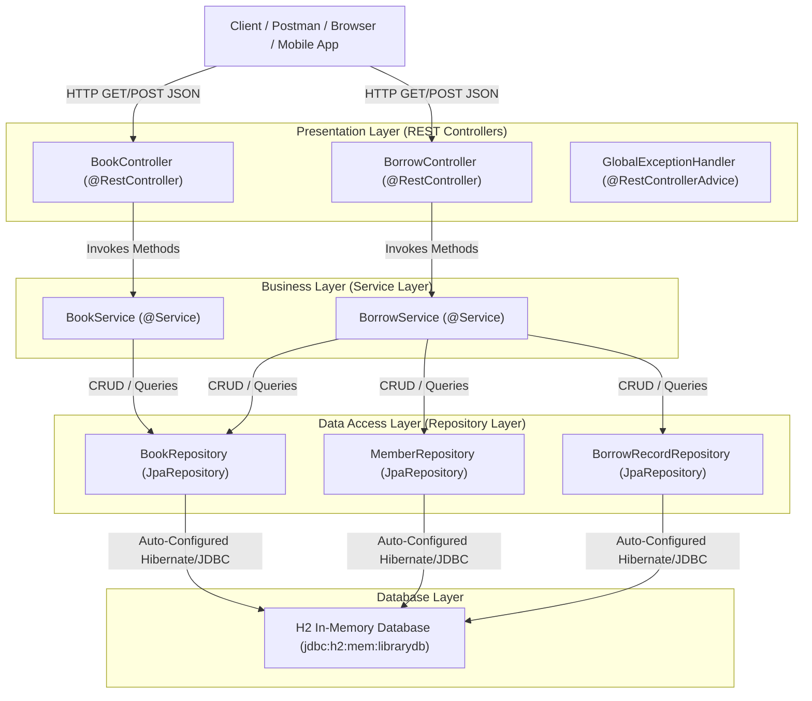

# Full-stack-assignment4
# Library Management System (LMS) - Spring Boot Application

## 1. Application Name & Problem Description
* **Application Name:** Library Management System (LMS)
* **Domain:** Education / Library Resource Management
* **Problem Description:**  
  Educational institutions and public libraries require an automated, reliable system to track books, patron memberships, and loan transactions. Manual tracking leads to book loss, inaccurate inventory records, and unfair borrowing without proper enforcement of membership borrow quotas or overdue late fines.  
  This application provides a **robust, three-tier Spring Boot REST API** that manages books, members, and loan transactions while enforcing two business rules:
  1. Borrow quota and real-time inventory eligibility validation.
  2. Automatic overdue late fine calculation upon book return.

---

## 2. Architecture Diagram (Three-Tier Architecture)



---

## 3. Domain Model / Classes

The application models **three core domain entities**:

### 1. `Book` Entity
* `id` (`Long`, Primary Key) – Auto-generated identifier.
* `title` (`String`) – Title of the book.
* `author` (`String`) – Author of the book.
* `isbn` (`String`) – International Standard Book Number.
* `category` (`String`) – Genre/category (e.g., Software, Fiction).
* `totalCopies` (`int`) – Total copies owned by the library.
* `availableCopies` (`int`) – Copies currently available for borrowing.

### 2. `Member` Entity
* `id` (`Long`, Primary Key) – Auto-generated identifier.
* `name` (`String`) – Full name of the member.
* `email` (`String`) – Contact email address.
* `membershipType` (`String`) – Membership tier (`STANDARD`, `PREMIUM`).
* `borrowedBooksCount` (`int`) – Number of books currently borrowed.
* `maxBorrowLimit` (`int`) – Maximum books permitted at one time (e.g., 2 for Standard, 5 for Premium).

### 3. `BorrowRecord` Entity
* `id` (`Long`, Primary Key) – Unique loan transaction identifier.
* `bookId` (`Long`) – Foreign reference to borrowed Book.
* `memberId` (`Long`) – Foreign reference to Member.
* `borrowDate` (`LocalDate`) – Date the book was borrowed.
* `dueDate` (`LocalDate`) – Standard return deadline (Borrow Date + 14 days).
* `returnDate` (`LocalDate`) – Actual return date (nullable until returned).
* `status` (`String`) – Status of loan (`ACTIVE`, `RETURNED`).
* `fineAmount` (`double`) – Accumulated overdue penalty fee ($2.00/day).

---

## 4. Project & Package Structure

```
d:/Coding/full stack ass4
├── pom.xml
└── src
    ├── main
    │   ├── java
    │   │   └── com
    │   │       └── example
    │   │           └── library
    │   │               ├── LibraryApplication.java
    │   │               ├── config
    │   │               │   └── DataInitializer.java
    │   │               ├── controller
    │   │               │   ├── BookController.java
    │   │               │   ├── BorrowController.java
    │   │               │   └── GlobalExceptionHandler.java
    │   │               ├── dto
    │   │               │   ├── BorrowRequest.java
    │   │               │   └── ReturnResponse.java
    │   │               ├── entity
    │   │               │   ├── Book.java
    │   │               │   ├── BorrowRecord.java
    │   │               │   └── Member.java
    │   │               ├── repository
    │   │               │   ├── BookRepository.java
    │   │               │   ├── BorrowRecordRepository.java
    │   │               │   └── MemberRepository.java
    │   │               └── service
    │   │                   ├── BookService.java
    │   │                   └── BorrowService.java
    │   └── resources
    │       └── application.properties
    └── test
        └── java
            └── com
                └── example
                    └── library
                        ├── controller
                        │   ├── BookControllerIntegrationTest.java
                        │   └── BorrowControllerTest.java
                        └── service
                            └── BorrowServiceTest.java
```

---

## 5. Controller Code

### `BookController.java`
* Path: `src/main/java/com/example/library/controller/BookController.java`
* Handles HTTP requests for catalog queries and book additions. Communicates exclusively with `BookService`.

### `BorrowController.java`
* Path: `src/main/java/com/example/library/controller/BorrowController.java`
* Handles HTTP POST for borrowing and returning books. Communicates exclusively with `BorrowService`.

---

## 6. Service Code

### `BorrowService.java`
* Path: `src/main/java/com/example/library/service/BorrowService.java`
* Implements core business logic and state transitions (`@Transactional`).

### `BookService.java`
* Path: `src/main/java/com/example/library/service/BookService.java`
* Provides query logic and validation for book inventory.

---

## 7. Repository Code

* `BookRepository.java`: Extends `JpaRepository<Book, Long>`
* `MemberRepository.java`: Extends `JpaRepository<Member, Long>`
* `BorrowRecordRepository.java`: Extends `JpaRepository<BorrowRecord, Long>`

---

## 8. REST Endpoints Catalog

| HTTP Method | Endpoint URL | Description | Sample Request Body | Response Code |
|:---|:---|:---|:---|:---|
| `GET` | `/api/books` | List all books | None | `200 OK` |
| `GET` | `/api/books/{id}` | Get book by ID | None | `200 OK` / `404 Not Found` |
| `GET` | `/api/books/search?category=Software` | Filter by category | Query Param | `200 OK` |
| `POST` | `/api/books` | Add new book | `{"title":"...","author":"...",...}` | `201 Created` |
| `POST` | `/api/borrow` | Borrow a book | `{"memberId":1,"bookId":1}` | `201 Created` / `400 Bad Request` |
| `POST` | `/api/borrow/return/{recordId}` | Return book & calc fine | Path Variable | `200 OK` / `400 Bad Request` |
| `GET` | `/api/borrow` | View all borrow records | None | `200 OK` |
| `GET` | `/api/borrow/member/{memberId}`| View member transactions | None | `200 OK` |

---

## 9. Business Rules Implemented

### Business Rule 1: Borrowing Eligibility & Inventory Allocation
* **Location:** `BorrowService.borrowBook(Long memberId, Long bookId)`
* **Logic:**
  1. Check if member exists and if current `borrowedBooksCount < member.getMaxBorrowLimit()`. If equal or exceeded, throw `IllegalStateException("Borrow limit exceeded...")`.
  2. Check if requested book has `availableCopies > 0`. If `0`, throw `IllegalStateException("Book is currently out of stock.")`.
  3. When both conditions pass:
     - Decrement `book.availableCopies` by 1.
     - Increment `member.borrowedBooksCount` by 1.
     - Create and save a new `BorrowRecord` with status `ACTIVE`, `borrowDate = now()`, and `dueDate = now() + 14 days`.

### Business Rule 2: Return Settlement & Overdue Fine Calculation
* **Location:** `BorrowService.returnBook(Long recordId, LocalDate returnDate)`
* **Logic:**
  1. Check if borrow record exists and its status is `ACTIVE`. (If already `RETURNED`, reject).
  2. If `returnDate` is after `dueDate`:
     - Calculate overdue days: `ChronoUnit.DAYS.between(dueDate, returnDate)`.
     - Fine = `daysOverdue * $2.00` per day.
  3. Update `BorrowRecord`: set status = `RETURNED`, `fineAmount = fine`, `returnDate = returnDate`.
  4. Restock book inventory (`availableCopies + 1`) and decrement member's borrowed count (`borrowedBooksCount - 1`).

---

## 10. Test Cases

| Test Case ID | Test Scenario | Input Data | Expected Output | Actual Output | Result |
|:---|:---|:---|:---|:---|:---|
| **TC-01** | Successful Book Borrowing | `memberId = 1` (Alice), `bookId = 1` (Clean Code) | `HTTP 201 Created`, status = `ACTIVE`, `availableCopies` reduced from 3 to 2 | `HTTP 201 Created`, record ID 2 created, status `ACTIVE`, copies decremented | **PASS** |
| **TC-02** | Borrow Limit Exceeded (Rule 1) | `memberId = 1` attempts 3rd book (Limit is 2) | `HTTP 400 Bad Request`, Message: *"Borrow limit exceeded..."* | `HTTP 400 Bad Request`, Business Rule Violation caught | **PASS** |
| **TC-03** | Overdue Fine Calculation (Rule 2) | `recordId = 1` (Returned 6 days late, rate = $2/day) | `HTTP 200 OK`, `daysOverdue = 6`, `fineAmount = 12.0`, status = `RETURNED` | `HTTP 200 OK`, `daysOverdue: 6`, `fineAmount: 12.0`, status `RETURNED` | **PASS** |

---

## 11. Automated Tests

Automated tests are written with **JUnit 5**, **Mockito**, and **Spring Boot Test / MockMvc**:

1. `com.example.library.service.BorrowServiceTest`:
   - `testBorrowBook_Success()` – verifies inventory and member state mutation upon successful borrowing.
   - `testBorrowBook_ExceedLimit_ThrowsException()` – tests Business Rule 1 limit rejection.
   - `testBorrowBook_OutOfStock_ThrowsException()` – tests Business Rule 1 stock depletion rejection.
   - `testReturnBook_OverdueFineCalculation()` – tests Business Rule 2 fine arithmetic.
2. `com.example.library.controller.BookControllerIntegrationTest`:
   - `testGetAllBooksEndpoint()` – verifies `@SpringBootTest` context loading and GET API response.
   - `testCreateBookEndpoint()` – verifies POST API book creation returning `201 Created`.
3. `com.example.library.controller.BorrowControllerTest`:
   - `testBorrowBookEndpoint()` – verifies `@WebMvcTest` JSON serialization and mock service integration.
   - `testReturnBookEndpoint()` – verifies fine response mapping.
   - `testGetAllBorrowRecordsEndpoint()` – verifies transaction listing.

### Test Execution Result:
```
[INFO] Running com.example.library.controller.BookControllerIntegrationTest
[INFO] Tests run: 2, Failures: 0, Errors: 0, Skipped: 0
[INFO] Running com.example.library.controller.BorrowControllerTest
[INFO] Tests run: 3, Failures: 0, Errors: 0, Skipped: 0
[INFO] Running com.example.library.service.BorrowServiceTest
[INFO] Tests run: 4, Failures: 0, Errors: 0, Skipped: 0
[INFO] 
[INFO] Results:
[INFO] Tests run: 9, Failures: 0, Errors: 0, Skipped: 0
[INFO] BUILD SUCCESS
```

---

## 12. Application Running Output

```
  .   ____          _            __ _ _
 /\\ / ___'_ __ _ _(_)_ __  __ _ \ \ \ \
( ( )\___ | '_ | '_| | '_ \/ _` | \ \ \ \
 \\/  ___)| |_)| | | | | || (_| |  ) ) ) )
  '  |____| .__|_| |_|_| |_\__, | / / / /
 =========|_|==============|___/=/_/_/_/

 :: Spring Boot ::                (v3.3.4)

2026-10-07T13:00:35.879+05:30  INFO 20844 --- [library-management-system] [           main] com.example.library.LibraryApplication   : Starting LibraryApplication using Java 21.0.12.1 with PID 20844
2026-10-07T13:00:36.640+05:30  INFO 20844 --- [library-management-system] [           main] .s.d.r.c.RepositoryConfigurationDelegate : Finished Spring Data repository scanning. Found 3 JPA repository interfaces.
2026-10-07T13:00:37.247+05:30  INFO 20844 --- [library-management-system] [           main] o.s.b.w.embedded.tomcat.TomcatWebServer  : Tomcat initialized with port 8080 (http)
2026-10-07T13:00:37.596+05:30  INFO 20844 --- [library-management-system] [           main] com.zaxxer.hikari.pool.HikariPool        : HikariPool-1 - Added connection conn0: url=jdbc:h2:mem:librarydb user=SA
2026-10-07T13:00:39.339+05:30  INFO 20844 --- [library-management-system] [           main] j.LocalContainerEntityManagerFactoryBean : Initialized JPA EntityManagerFactory for persistence unit 'default'
2026-10-07T13:00:40.193+05:30  INFO 20844 --- [library-management-system] [           main] o.s.b.w.embedded.tomcat.TomcatWebServer  : Tomcat started on port 8080 (http) with context path '/'
2026-10-07T13:00:40.202+05:30  INFO 20844 --- [library-management-system] [           main] com.example.library.LibraryApplication   : Started LibraryApplication in 4.757 seconds
>>> [LibraryApp] Initial sample data successfully seeded into H2 Database.
```

---

## 13. REST Endpoints Sample Outputs

### 1. `GET /api/books`
```json
[
  {
    "id": 1,
    "title": "Clean Code",
    "author": "Robert C. Martin",
    "isbn": "978-0132350884",
    "category": "Software",
    "totalCopies": 3,
    "availableCopies": 3
  },
  {
    "id": 2,
    "title": "Spring in Action",
    "author": "Craig Walls",
    "isbn": "978-1617294945",
    "category": "Software",
    "totalCopies": 1,
    "availableCopies": 1
  },
  {
    "id": 3,
    "title": "The Great Gatsby",
    "author": "F. Scott Fitzgerald",
    "isbn": "978-0743273565",
    "category": "Fiction",
    "totalCopies": 2,
    "availableCopies": 1
  }
]
```

### 2. `POST /api/borrow` (Borrowing a Book)
**Request Body:**
```json
{
  "memberId": 1,
  "bookId": 1
}
```
**Response (201 Created):**
```json
{
  "id": 2,
  "bookId": 1,
  "memberId": 1,
  "borrowDate": "2026-10-07",
  "dueDate": "2026-10-21",
  "returnDate": null,
  "status": "ACTIVE",
  "fineAmount": 0.0
}
```

### 3. `POST /api/borrow/return/1` (Returning Overdue Book - Fine Applied)
**Response (200 OK):**
```json
{
  "recordId": 1,
  "bookId": 3,
  "memberId": 2,
  "returnDate": "2026-10-07",
  "daysOverdue": 6,
  "fineAmount": 12.0,
  "statusMessage": "Book returned with overdue fine of $12.00 (6 days overdue)."
}
```

---

## 14. Spring Boot Auto-Configuration Explanation

Spring Boot replaces cumbersome manual XML and Java bean configurations through its **Auto-Configuration** mechanism:

1. **`@SpringBootApplication` Annotation**:
   - Meta-annotated with `@EnableAutoConfiguration`, which triggers Spring Boot's opinionated configuration guessing based on JAR dependencies present on the classpath.
2. **Web Layer Auto-Configuration (`spring-boot-starter-web`)**:
   - Automatically registers and starts an embedded **Tomcat web server** on port 8080 without requiring an external servlet container (WAR deployment).
   - Configures the **`DispatcherServlet`**, `HandlerMapping`, and Jackson `ObjectMapper` for JSON request/response serialization.
3. **Data Access Layer Auto-Configuration (`spring-boot-starter-data-jpa` & `h2`)**:
   - Detects the H2 driver on the classpath and automatically creates a **`HikariDataSource`** connection pool to `jdbc:h2:mem:librarydb`.
   - Auto-configures Hibernate's **`LocalContainerEntityManagerFactoryBean`** and **`JpaTransactionManager`**.
   - Dynamically implements the `JpaRepository` interfaces (`BookRepository`, `MemberRepository`, `BorrowRecordRepository`) at runtime without requiring boilerplate DAO implementation classes.
4. **Zero-Boilerplate Component Scanning (`@ComponentScan`)**:
   - Scans the root package `com.example.library` and automatically registers all `@RestController`, `@Service`, `@Repository`, and `@Component` classes as Spring beans with dependency injection.
